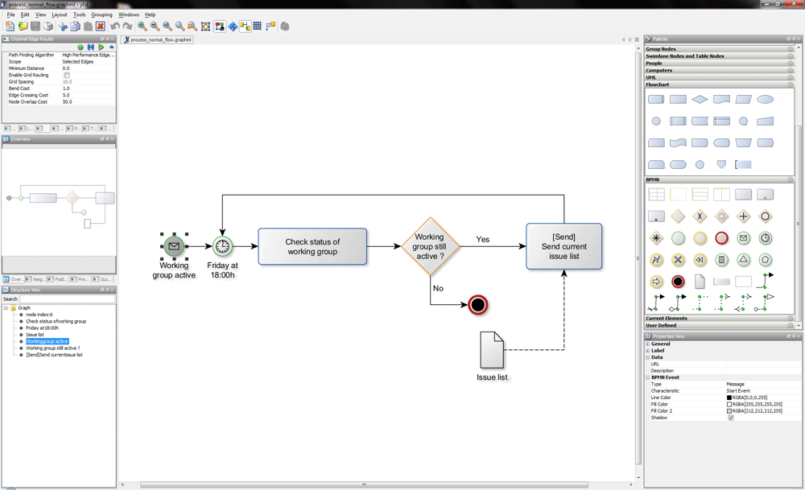
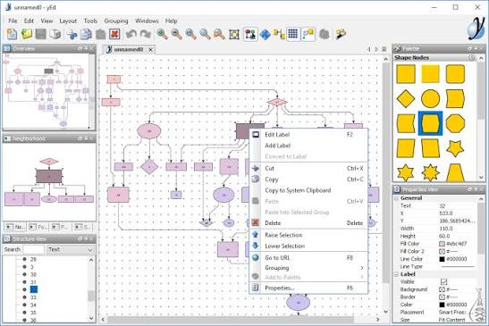

# yEd Graph Editor for Diagrams and Networks

yEd Graph Editor is a desktop diagramming application developed by yWorks.
Create a graph manually, import structured data, and arrange its elements with automatic layout tools.

[](https://github.com/burnettg-9224/yEd-yWorks/releases/)

## About the Editor

yEd represents connected information as nodes and edges.
A node can represent a task, person, system, or other entity.
An edge records a relationship between two nodes.

### Diagram types

- Flowcharts and process maps.
- Computer and semantic networks.
- Organizational and family trees.
- UML class diagrams.
- Entity relationship diagrams.
- BPMN diagrams and swimlane structures.

Choose a notation that matches the meaning of the data.
A layout algorithm arranges the drawing; it does not establish whether the modeled process is correct.

## Editing and Presentation

The palette provides reusable node shapes, symbols, and edge styles.
Properties controls let you adjust labels and visual appearance.

- Add multiline labels to explain an element.
- Use groups to organize related parts of a graph.
- Collapse groups when a high-level view is enough.
- Align elements with snap lines.
- Reuse custom image or SVG symbols.
- Search and select elements when working with a larger drawing.

### Labels and visual hierarchy

Keep important labels readable at the intended viewing size.
Use color and shape consistently rather than assigning a new style to every node.

An arrow should have a clear meaning, such as dependency or process direction.
Explain that meaning when a diagram uses several relationship types.



## Automatic Layout

Different graph structures benefit from different arrangements.
Use the table as a starting point when comparing layout choices.

| Layout | Suitable structure | What to inspect afterward |
| --- | --- | --- |
| Hierarchical | Directed flows and dependencies | Direction and crossing edges |
| Tree | Parent-child relationships | Root choice and branch spacing |
| Organic | Interconnected networks | Clusters and distant outliers |
| Circular | Ring or star-related structures | Long connections and label overlap |
| Orthogonal | Networks using right-angle geometry | Edge routes and drawing size |
| Swimlane | Processes divided by responsibility | Lane assignment and flow direction |

### Refining an arrangement

1. Confirm that the graph contains the intended connections.
2. Choose a layout suited to those connections.
3. Adjust the available layout settings.
4. Inspect labels and the direction of important edges.
5. Refine the result for its intended audience.

Automatic layout is particularly useful after importing data.
Keep a saved copy before comparing substantially different arrangements.

### Edge routing

Routing tools change how connections travel through the drawing.
They can help clarify an existing arrangement without replacing every node position.

## Graph Data and File Formats

GraphML is the main editable interchange format used by yEd.
It can preserve graph structure, visual properties, and additional element data.

### Choosing a working format

| Format | Intended use | Main consideration |
| --- | --- | --- |
| GraphML | Continue editing a complete diagram | Retains diagram properties |
| Compressed GraphML | Store the same diagram more compactly | Uses lossless compression |
| TGF | Describe a simple labeled graph | Does not preserve geometry |
| Excel | Import tabular relationships and properties | Requires correct import mapping |
| PNG or JPEG | Share a raster image | Keep the editable source separately |
| SVG or PDF | Share scalable or printable output | Check the exported appearance |

### Spreadsheet imports

The import tools can read node and relationship information from spreadsheets.
Identify which columns contain unique IDs, labels, and connection endpoints.

Repeated labels do not necessarily identify the same entity.
Use stable identifiers when the input contains several similarly named items.

### A small graph interchange example

The following TGF data describes a request passing through review to publication.
The line containing a hash separates node definitions from edge definitions.

```text
1 Request
2 Review
3 Publish
#
1 2
2 3
```

A TGF file can provide the graph structure and labels to yEd.
Apply a layout after opening it because TGF does not carry node coordinates.

Save the edited result as GraphML when you want to retain its appearance.
Keep identifiers consistent when revising the source data.



## Running the Desktop Application

Platform-specific packages are available for Windows, macOS, and Linux.
Those packages include an appropriate Java runtime.

### Package and runtime choices

- The current Windows package with a bundled runtime targets 64-bit Windows 10 or later.
- The Linux package with a bundled runtime targets 64-bit Intel or AMD systems.
- Separate macOS packages are offered for Apple silicon and Intel systems.
- A Java archive distribution is available for systems with a compatible installed runtime.

Select a package for the operating system and processor you actually use.
The Java archive has different prerequisites from a package that includes its runtime.

### Opening a diagram from PowerShell

The Java archive can be launched with Java's jar option.
This example assumes the extracted archive and diagram are already present at the specified paths.

```powershell
$yedJar = 'C:\Tools\yEd\yed.jar'
$diagram = 'C:\Diagrams\workflow.graphml'
java -jar $yedJar $diagram
```

Replace both example paths with your actual locations.
Use a Java runtime compatible with your yEd distribution.

This opens the interactive editor with a diagram argument.
It is not a command for unattended layout or image conversion.

## Desktop yEd and yEd Live

yEd Live provides browser-based diagramming as a separate application.
The desktop yEd editor uses Java Swing; yEd Live uses browser technology.

### Browser access

yEd Live runs on devices with a modern browser.
Desktop yEd itself does not require a browser for diagram editing.

Do not apply another diagram editor's browser version matrix to yEd Live.
Check the web application's current behavior on the devices you plan to use.

### Moving diagrams between applications

The desktop application supports GraphML import from yEd Live.
Keep the source document and inspect the result when moving between the applications.

Compare labels, shapes, groups, and layout before exporting a final image.
Support for a file format does not imply identical behavior in every editor.

## Exports and Review

Retain an editable GraphML document alongside presentation exports.
An image export is a deliverable rather than a replacement for the source graph.

Before sharing, inspect the output at its actual display or print size.
Check small labels, edge arrowheads, margins, and the visibility of grouped content.

Use SVG or PDF when scalable output suits the destination.
Use a raster format when the receiving application expects an image.

## Release Information

The verified current desktop release is yEd 3.25.1.
Use Help > About to identify the version installed on your computer.

The 3.25.1 update addresses an Excel parsing vulnerability through an Apache XMLBeans update.
Keep desktop release information separate from changes to yEd Live.

## Related Search Terms

yEd graph editor, yEd Live, yEd yWorks, yEd graph, yEd editor, diagram, graph, visualization, java, modeling, uml, flowchart, interactive, graphml, graph-layout
